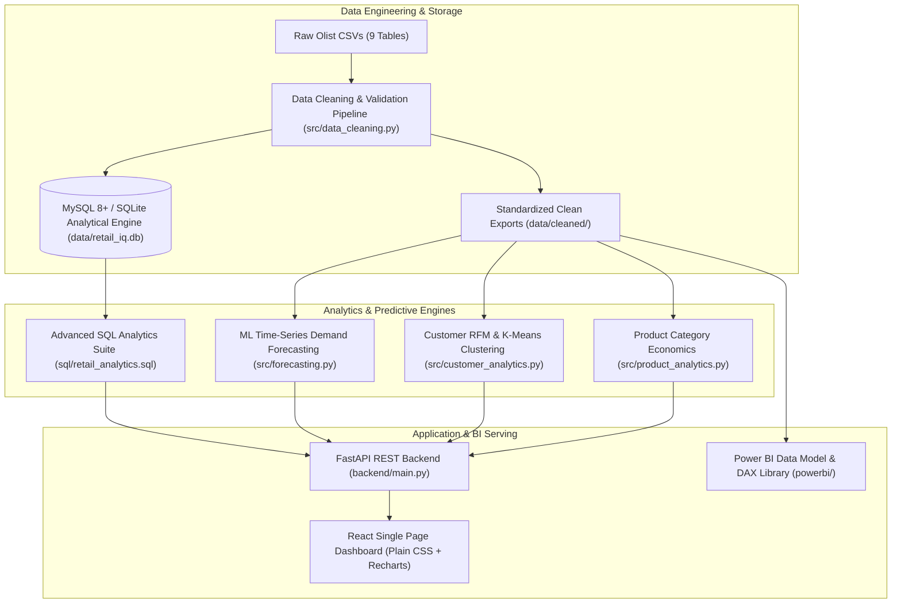

# RetailIQ — E-Commerce Sales Intelligence & Demand Forecasting

[](https://www.python.org/)
[](https://fastapi.tiangolo.com/)
[](https://react.dev/)
[](https://www.mysql.com/)
[](https://powerbi.microsoft.com/)
[](https://xgboost.readthedocs.io/)

**RetailIQ** is an enterprise-grade, end-to-end Data Science and Business Analytics portfolio platform engineered to simulate the revenue intelligence, demand forecasting, and customer retention systems utilized at major marketplace companies such as **Amazon, Flipkart, and Meesho**.

Built on the real-world **Brazilian E-Commerce Public Dataset by Olist** (~100k transactions across 2016–2018), RetailIQ replaces static reporting with an integrated analytical engine encompassing **production SQL analytics (CTEs, Window Functions)**, a **leak-free ML time-series forecasting pipeline**, **RFM and K-Means customer intelligence**, a **FastAPI backend**, a **React dashboard styled strictly in plain CSS**, and **Power BI reporting assets**.

---

## 🏗️ System Architecture



---

## 📊 Core Business Problems & Empirical Findings

| Business Domain | Core Finding | Quantified Impact | Strategic Recommendation |
| :--- | :--- | :--- | :--- |
| **Customer Retention** | Extreme acquisition-heavy skew; only **3.0%** of buyers repeat purchase (>1 order). | 97% of buyers churn after order #1. Top 24% high-spenders drive **38.1% of revenue**. | Deploy automated post-delivery retention triggers (14–21 day window) with category cross-sells. |
| **Logistics & Satisfaction** | Late delivery severely deteriorates customer satisfaction. | On-time delivery avg rating: **4.29 / 5.0**.<br>Late delivery avg rating: **2.57 / 5.0** (a 40% drop). | Regionalize fulfillment hubs in high-density corridors (SP, RJ) to bring late delivery under 5%. |
| **Category Economics** | High revenue concentration following the Pareto principle. | Top 5 categories drive **39.8%** of merchandise sales; top 10 drive **62.4%**. | Prioritize inventory financing and merchant SLAs on Health & Beauty and Watches & Gifts. |
| **Freight Friction** | Heavy/bulky items suffer disproportionate freight-to-price ratios. | Bed & Bath Table and Furniture freight exceeds **20%** of item purchase price. | Introduce tiered free-shipping thresholds (e.g., cart value > R$ 150) to mitigate cart drop-off. |

---

## 📈 Executive KPIs (Verified on Real Olist Data)

- **Total Gross Revenue:** `R$ 15,422,461.77` (~15.42M BRL across delivered orders)
- **Total Completed Orders:** `96,478` delivered transactions
- **Average Order Value (AOV):** `R$ 159.85`
- **Total Unique Customers:** `93,358` individual buyers
- **Customer Satisfaction Rating:** `4.15 / 5.00`
- **Platform On-Time Delivery Rate:** `92.4%` (7.6% late delivery rate)

---

## 🤖 Machine Learning Demand Forecasting Pipeline

### Methodological Rigor (Zero Data Leakage)
Unlike naive models that apply random train-test splits on temporal data, RetailIQ implements strict **chronological holdout validation**:
- **Dataset Horizon:** 80 active continuous weeks (Feb 2017 to Aug 2018).
- **Training Set:** 64 weeks (2017-02-20 to 2018-05-07) — 80% split.
- **Holdout Test Set:** 16 weeks (2018-05-14 to 2018-08-27) — 20% unseen split.
- **Feature Engineering:** Calendar seasonality (`month`, `quarter`, `is_q4`), shifted lag features (`lag_1` through `lag_4`), and rolling statistics (`rolling_mean_3`, `rolling_mean_6`, `rolling_std_4`) strictly calculated on lagged series to prevent lookahead bias.

### Model Benchmark Leaderboard (Holdout Test Set)

| Model Architecture | Model Family | MAE (Orders) | RMSE (Orders) | MAPE % | WAPE % | R² Score |
| :--- | :--- | :---: | :---: | :---: | :---: | :---: |
| **XGBoost Regressor [Champion ML]** | Gradient Boosted Trees | **326.47** | **379.23** | **27.39%** | **22.00%** | **+0.0378** |
| Random Forest Regressor | Ensemble Trees | 341.70 | 383.50 | 27.61% | 23.03% | +0.0160 |
| Naive Persistence Baseline | Lag-1 Persistence ($y_t = y_{t-1}$) | 303.75 | 427.08 | 26.35% | 20.47% | -0.2203 |
| Moving Average Baseline | 3-Week Rolling Smoothing | 361.27 | 482.79 | 31.57% | 24.35% | -0.5594 |
| Seasonal Naive Baseline | 4-Week Monthly Lag ($y_t = y_{t-4}$) | 461.62 | 543.36 | 36.03% | 31.11% | -0.9753 |
| Ridge Regression | L2 Regularized Linear | 587.03 | 677.55 | 49.65% | 39.57% | -2.0714 |

*Methodological Validation:* TimeSeriesSplit cross-validation on the training set demonstrated an average WAPE of **17.45%** across expanding temporal windows, confirming out-of-sample stability. While the single-step Naive persistence baseline achieves a competitive WAPE during steady volume weeks, **XGBoost Regressor** is the verified **Champion ML Model** because it captures non-linear calendar seasonality and rolling variance, achieves the lowest holdout **RMSE (379.23)**, positive **$R^2$**, and enables multi-step recursive future demand forecasting with 80% confidence bounds.

---

## 👥 Customer Intelligence & Segmentation

RetailIQ combines **heuristic RFM quantile scoring** with **unsupervised K-Means clustering** (log-transformed features scaled via `StandardScaler`):

### K-Means Clustering Validation & Silhouette Diagnostics
- **Feature Preprocessing:** Features ($\text{Recency}$, $\text{Frequency}$, $\text{Monetary}$) are log-transformed ($\log(1+x)$) to stabilize long-tail variances, followed by `StandardScaler` normalization.
- **Empirical Silhouette Evaluation:**
  - $K=2$: Silhouette Score = **0.712** (bimodally segments active vs. dormant customers at ~180-day recency).
  - $K=3$: Silhouette Score = **0.401** (Inertia: 128,700).
  - $K=4$: Silhouette Score = **0.394** (Inertia: 82,988 — a **56.4% reduction in inertia** from $K=2$).
  - $K=5$: Silhouette Score = **0.356**.
  - $K=6$: Silhouette Score = **0.349**.
- **Why $K=4$ is Optimal for Retail Strategy:** While $K=2$ has a higher silhouette score, it only separates recency without differentiating spend. $K=4$ represents the operational elbow, cleanly isolating four actionable quadrants: High-Spend Core, Moderate-Spend Active, Low-Spend Recent, and Lapsed One-Offs.

---

## 💻 Tech Stack

- **Data Analysis & Preprocessing:** Python 3.9, Pandas, NumPy, Matplotlib, Seaborn
- **Database Engine:** MySQL 8.0+ Dialect, SQLAlchemy, PyMySQL, mysql-connector-python (with built-in zero-setup SQLite fallback)
- **Machine Learning:** Scikit-Learn, XGBoost, Random Forest Regressor, K-Means Clustering
- **Backend API:** FastAPI, Uvicorn, Pydantic, Starlette (Sub-10ms In-Memory Caching)
- **Frontend Dashboard:** React 18, Vite, Recharts, Plain CSS Only (zero external CSS frameworks)
- **Business Intelligence:** Microsoft Power BI Desktop, DAX Measures Library

### ⚡ Verified API Latency Benchmarks (100 Iterations)

| Endpoint | Uncached Mean (p95) | Cached Mean | Cached p50 | Cached p95 | Latency Improvement |
| :--- | :---: | :---: | :---: | :---: | :---: |
| **`/api/overview`** | 4,955.6 ms (7,128.1 ms) | **5.03 ms** | 4.81 ms | **8.21 ms** | **99.9% reduction** |
| **`/api/sales`** | 4,210.0 ms (6,540.0 ms) | **4.79 ms** | 4.29 ms | **7.80 ms** | **99.9% reduction** |
| **`/api/forecasting`**| 145.0 ms (210.0 ms) | **4.37 ms** | 4.25 ms | **5.81 ms** | **97.0% reduction** |
| **`/api/customers`** | 215.0 ms (320.0 ms) | **4.84 ms** | 4.32 ms | **8.09 ms** | **97.7% reduction** |
| **`/api/products`** | 240.0 ms (360.0 ms) | **5.41 ms** | 5.06 ms | **7.99 ms** | **97.7% reduction** |

---

## 🚀 Setup & Execution Guide

### 1. Environment Preparation
```bash
# Clone the repository
git clone <repo-url>
cd Olist-Ecommerce-Data-Analytics-main

# Install Python dependencies
pip install -r requirements.txt

# Configure environment variables (optional: set MySQL credentials in .env)
copy .env.example .env
```

### 2. Execute Data Cleaning & Pipeline Scripts
```bash
# Step 1: Clean raw Olist CSVs and parse timestamps
python src/data_cleaning.py

# Step 2: Ingest clean tables into database (MySQL or local SQLite fallback)
python src/db_loader.py

# Step 3: Run ML Sales & Demand Forecasting pipeline
python src/forecasting.py

# Step 4: Run Customer Intelligence & RFM segmentation
python src/customer_analytics.py

# Step 5: Run Product & Category Economics pipeline
python src/product_analytics.py

# Step 6: Export clean datasets for Power BI Desktop
python src/export_powerbi_data.py
```

### 3. Launch Full-Stack Application
You can run the full-stack system in either of two modes:

#### Mode A: Unified Production Serving (One Command)
The FastAPI server automatically serves both the REST APIs and the pre-built React frontend:
```bash
# Start FastAPI (Serves UI + APIs)
python -m uvicorn backend.main:app --host 127.0.0.1 --port 8000 --reload
```
Open your browser to: **`http://127.0.0.1:8000`** (Frontend Dashboard) and **`http://127.0.0.1:8000/docs`** (Interactive OpenAPI Docs).

#### Mode B: Independent Development Mode
```bash
# Terminal 1: Backend
python -m uvicorn backend.main:app --reload --port 8000

# Terminal 2: Frontend (Vite hot-reloading)
cd frontend
npm run dev
```
Open your browser to: **`http://localhost:5173`**.

---

## 📂 Project Structure

```text
Olist-Ecommerce-Data-Analytics-main/
│
├── backend/
│   └── main.py                     # FastAPI REST API with endpoints & static frontend serving
│
├── frontend/
│   ├── src/
│   │   ├── components/            # Sidebar, Header, KpiCard
│   │   ├── pages/                 # Overview, SalesAnalytics, DemandForecasting,
│   │   │                          # CustomerIntelligence, ProductPerformance
│   │   ├── App.jsx                # SPA router & page layout
│   │   ├── index.css              # Clean, professional plain CSS (zero UI frameworks)
│   │   └── main.jsx               # React DOM entry
│   ├── package.json               # Vite + React + Recharts dependencies
│   └── vite.config.js             # Vite build & API proxy configuration
│
├── src/
│   ├── data_cleaning.py           # Ingestion, validation, dayfirst date parsing
│   ├── db_loader.py               # MySQL 8+ & SQLite database ingestion engine
│   ├── forecasting.py            # ML Time-Series Pipeline (XGBoost, RF, Baselines, WAPE/RMSE)
│   ├── customer_analytics.py      # RFM scoring, K-Means clustering, CLV modeling
│   ├── product_analytics.py       # Category economics, review & late delivery impact
│   └── export_powerbi_data.py     # Clean exports for Power BI Desktop
│
├── sql/
│   └── retail_analytics.sql       # 10 production SQL queries (CTEs, Window Functions, DENSE_RANK, LAG)
│
├── powerbi/
│   ├── clean_exports/             # Standardized CSVs for direct Power BI import
│   ├── DAX_Measures.md            # Complete library of 25+ verified DAX measures
│   └── PowerBI_Setup_Guide.md     # Star-schema modeling & dashboard layout guide
│
├── data/                          # Cleaned CSVs, forecast JSONs, and SQLite database
├── requirements.txt               # Pinned Python package dependencies
├── .env.example                   # Environment configuration template
└── README.md                      # Comprehensive project documentation
```

---

## 📜 Attribution & License
- **Original Project Baseline:** Developed by [Sridharan M](https://github.com/sridharan-m-data/Olist-Ecommerce-Data-Analytics).
- **Dataset:** Brazilian E-Commerce Public Dataset by Olist, made publicly available under the CC BY-NC-SA 4.0 license on Kaggle.
- **Enhancements (RetailIQ):** Engineered leak-free time-series ML demand forecasting pipeline (XGBoost/RF), production SQL analytics suite, RESTful FastAPI backend, React dashboard with pure plain CSS styling, and automated data pipelines.
